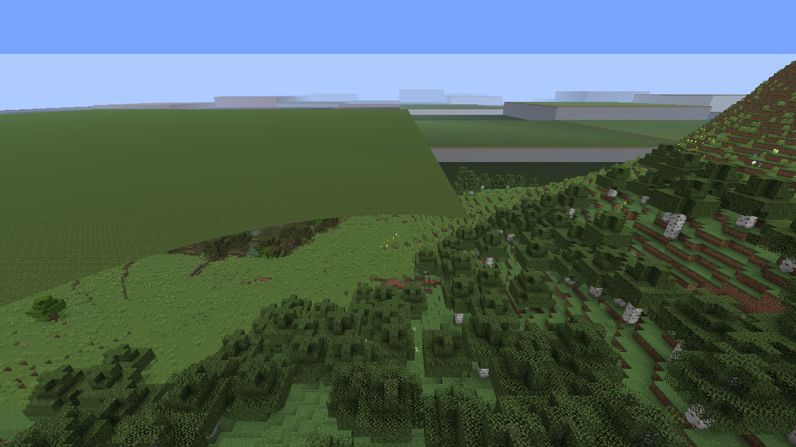
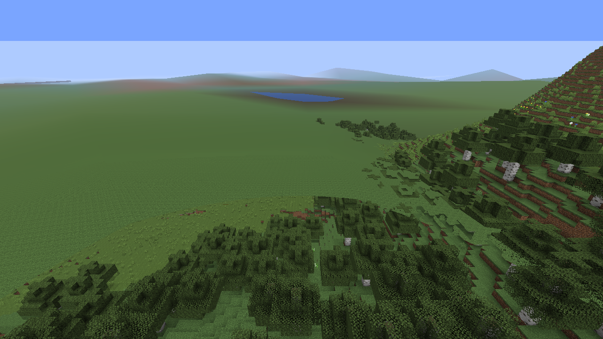
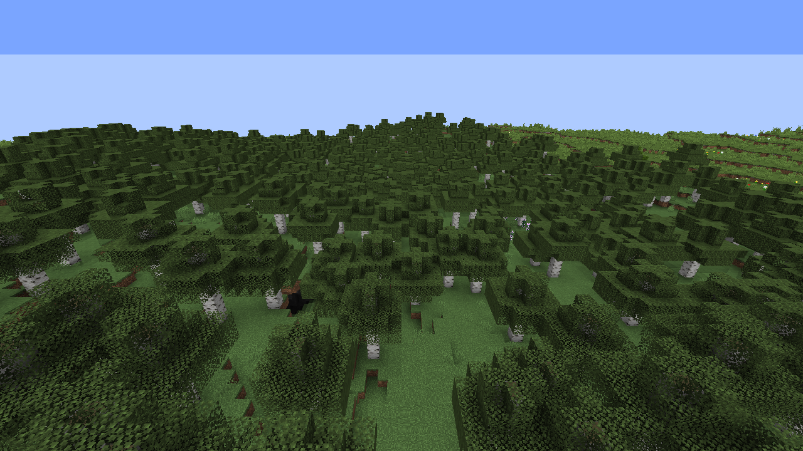

# RTF 渲染质量验证 · 0.0.2

本轮世界测试使用 NeoTerraForged 0.0.6 生成的默认预设与海平面提高 9 格的自定义预设。启动前检查噪声生成器、已启用的数据包和 RTF 注册表目录，拒绝超平坦测试世界。正式存档、整合包配置和云端服务器均未修改。

## 粗预测的大方块

在自定义 RTF 山地实景中复现了 VSS 粗预测把采样点扩成大片平顶平台及垂直墙面。新选项将粗采样点连接成连续山坡；相邻单元共用边缘高度，不额外请求服务器或生成真实区块。实际游戏中的打包网格测试覆盖山坡顶点、共边、捕获的洞穴、精细方块、关闭开关及液面高度。

同一 RTF 位置的开发中修复前后截图：

这是首次加载时的粗预览。远处植被和细节仍需继续生成；它不是精修后的效果，也不能用地表采样命中率宣称整幅画面相似度。精细模型、三维体积和复杂结构保留 VSS 拓扑，未把所有模型强制改成斜面。

## 区块交界

复现并修正了 NeoVoxy 原有遮罩状态错误：同一帧内卸载再加载、取消尚未提交的加载，以及重建时残留的待处理队列。没有区块时也清空旧深度遮罩。原始 NeoVoxy 与 0.0.1 在对应状态测试中均失败，新版通过。

森林及山地实景先加载原版半径 8 区块，再降到 2 区块并重建渲染器，检查真实区块与已缓存 LOD 的交界。使用相同 RTF 世界、位置、视角、时间和无光影环境，对照原始 NeoVoxy、0.0.1 与 0.0.2；截图中的天空色用于辅助检查原有地形区域是否变成背景，并人工检查交界；不把这项颜色诊断当作深度测量。

用户报告的整圈白色接缝在这组固定视点中未稳定复现，因此不能据此宣称白边在所有环境下彻底消失。此次修复针对已复现的遮罩错误；亮色像素计数还会包含自然方块、雾和天空，不能单独当作接缝检测。

森林参考地形区域 650,062 像素、山地 522,220 像素；新版相对原始 NeoVoxy 新增的天空色像素均为 0。三个版本中亮色中性像素分别都是森林 11、山地 26。这是两个固定场景的对照结果，不能推断所有场景没有白边。

## 预测、水面与深度

VSS 原有适配没有识别 NeoVoxy 0.6.1 的深度着色器格式，透明阶段回调签名也不匹配。现在适配其实际格式和回调，运行时测试确认预测在水面之前绘制。独立 GPU 测试验证不同深度编码、较近预测遮挡较远水面，以及关闭开关恢复原路径。光影使用其自身绘制路径，本次实景验证未覆盖所有光影包。

钠 → Fantasy Town Voxy → 地形预测中，两项新策略均可关闭。保留用户原有的预测总开关、渲染方式和性能调度选择，真实 LOD 缓存不因粗预测网格变化而删除。

具体像素计数、JAR 哈希和运行范围见发布包 `validation-summary.json` 的 `quality` 字段；地形采样定义另见 [准确度报告](PREDICTION_ACCURACY.zh-CN.md)。
