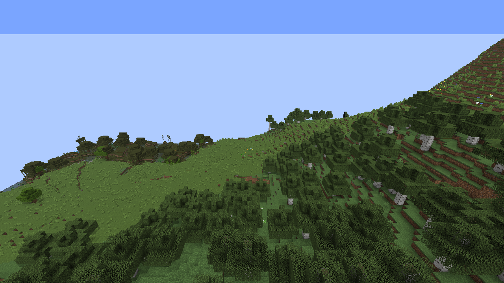
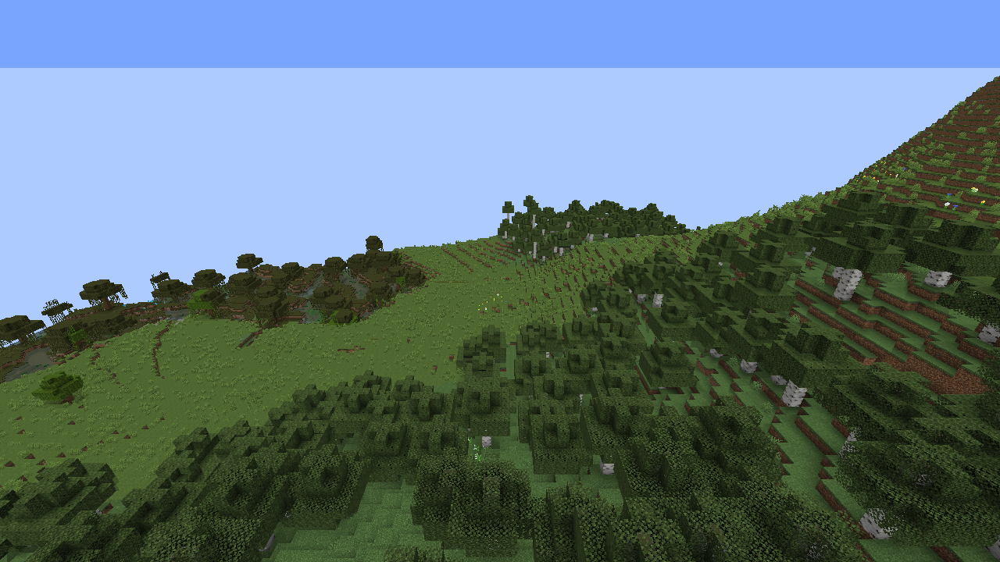

# RTF 渲染质量验证 · 0.3.0

JAR SHA256：`d1962b29b19b0452a7af4fef2f0350c2820990842e9700650bfc65ce220523fa`。

本轮使用 NeoTerraForged 默认预设和海平面提高 9 格的自定义预设；启动前核对噪声生成器与 RTF 数据包，不使用超平坦。正式存档和客户端配置未修改。

## 默认画质优先

预测必须完成 64×64 网格、采样间距不超过 2 格才允许显示。普通和 Iris 路径共用过滤后的绘制及覆盖列表，粗块不能隐藏本来应该显示的真实 LOD。预测内部仍可生成和缓存粗采样，作为后续精修的输入，但不会拿来占位。

原生客户端反例：0.0.2 的实际 RenderSnapshot 接纳了粗网格和未精修缓存，新版拒绝它们，同时保留两种合格精细网格、原始缓存集合及开关关闭后的原行为。钠的实际“应用”按钮已测试关闭/开启和在线重建。

自定义 RTF 山地实景中，最多 1 块完整精细网格进入可用绘制列表，另有 2 块粗预测被过滤。实际绘制计数和预测/水面桥接均已执行；这不等于整个远方已达到 90% 像素或植被相似度。

独立 180 秒冷缓存对照：0.0.3 完整精细网格最多 0 块，新版最多 8 块；新版首次精细绘制 23.51 秒。两边使用同一自定义 RTF 山地、3 GiB Java 堆、2 个 NeoVoxy 工作线程及相同预测设置，未增加线程、降低采样密度或允许粗模。完整成本在发布包 predictionProgress 字段。

## 真实 LOD 交界对照

同一 RTF 世界、位置、视角和时间，先加载原版半径 8 区块，再降为 2 区块并重建渲染器。与保存的原始 NeoVoxy 和 0.0.1 视点比较。天空色和亮色中性像素仅作为图像辅助诊断，不等于深度测量或白缝识别。

| 场景 | 参考地形像素 | 相对原始 NeoVoxy 新增天空色 | 新版亮色中性像素 |
|---|---:|---:|---:|
| 森林 | 650062 | 0 | 11 |
| 山地 | 522220 | 0 | 26 |

用户报告的整圈白缝在这些固定视点中仍未稳定复现，不声称所有场景的白边已经消失。已有遮罩生命周期与深度投影 GPU 回归继续通过；本轮未覆盖所有光影包。

## 设置与代价

钠 → Fantasy Town Voxy → 地形预测 → LOD 画质优先，默认开启。“优先完成近处精细预测”独立控制生成顺序，关闭后保留画质过滤，恢复 VSS 原排序。较远处只有粗预测时等待精修或真实 LOD，可见预测范围可能小于设定距离。此策略不强制加线程或增加内存预算，性能预设保留开关。

“粗预测山坡（兼容选项）”默认关闭，仅在关闭画质优先后有效；旧配置保留的开启值不会绕过画质优先。已保存真实 LOD、用户预测总开关和 NeoVoxy/HXZ 渲染选择保留。

完整记录见发布包 validation-summary.json 的 quality 字段；地表采样精度另见 [准确度报告](PREDICTION_ACCURACY.zh-CN.md)。
